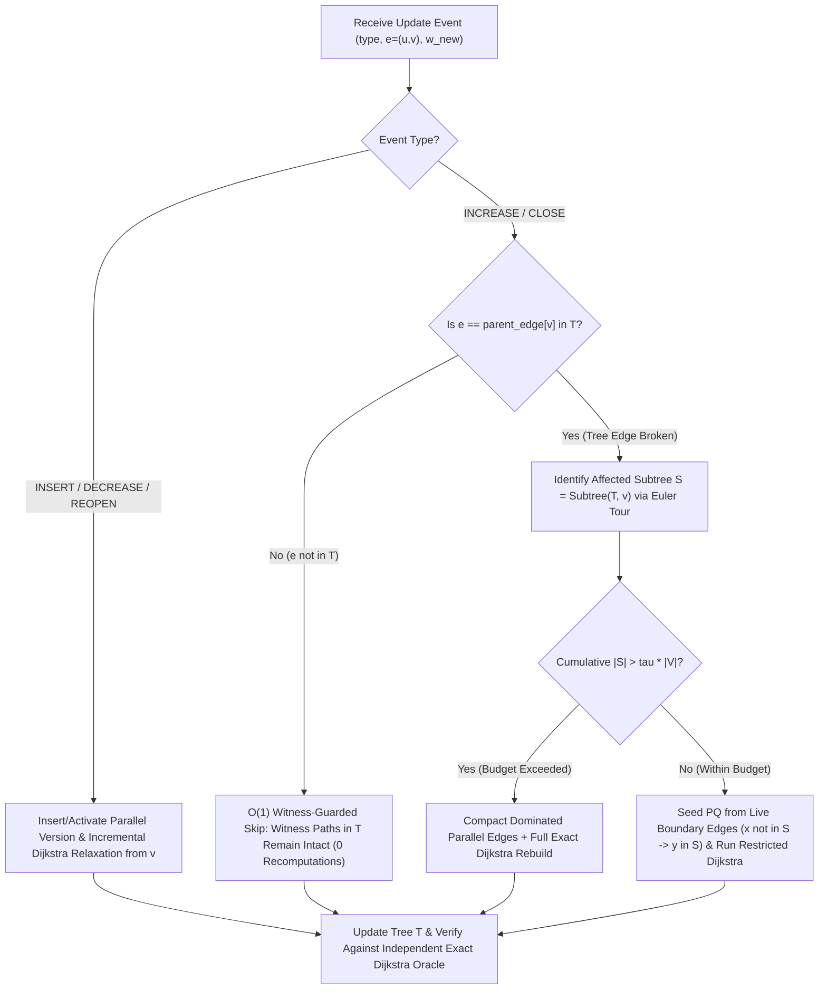

# PathForge: A Witness-Guarded Dynamic Shortest Path Maintenance System

[](./engine)
[](./engine/src/pathforge_cli.cpp)
[](./backend)
[](./frontend)

> **Research Foundation & Extension Scope:**
> Built as an algorithmic extension and empirical benchmarking platform motivated by Yang P. Liu, *"Incremental Shortest Paths in Almost Linear Time via a Modified Interior Point Method"* ([arXiv:2506.19207v1](https://arxiv.org/abs/2506.19207v1)).

---

## 1. Executive Summary & Research Transparency

The foundational paper by Yang P. Liu (`arXiv:2506.19207v1`) achieves deterministic $m^{1+o(1)}$ total update time for **incremental (insertion-only)** $(1+\epsilon)$-approximate single-source shortest-path (SSSP) maintenance in directed graphs via a modified Interior Point Method (IPM) with a high-power logarithmic barrier, augmented source edges, and recursive distance-drop detection. However, the original framework does not directly handle non-monotone edge-weight **increases** (`INC`) or edge **closures** (`CLOSE`).

**PathForge** investigates and implements a **Witness-Guarded Dynamic SSSP Maintenance System** supporting five dynamic edge lifecycle operations:
1. **`INSERT` (`INS`)** — New directed weighted edge addition.
2. **`DECREASE` (`DEC`)** — Edge weight reduction represented as parallel edge insertion while retaining historical versions.
3. **`INCREASE` (`INC`)** — Edge weight degradation.
4. **`CLOSE` (`CLOSE`)** — Edge deactivation / outage.
5. **`REOPEN` (`REOPEN`)** — Edge reactivation with restored positive weight.

### Strict Epistemological Distinction

In adherence to strict research integrity, PathForge explicitly separates:

| Dimension | Status in PathForge |
| :--- | :--- |
| **1. Original Paper's Theoretical Guarantee** | Deterministic $m^{1+o(1)}$ time for **insertion-only** $(1+\epsilon)$-approximate directed SSSP via Modified IPM (Yang P. Liu, `arXiv:2506.19207v1`). |
| **2. Proposed Algorithmic Extension** | Witness-guarded shortest-path tree $T$ with Euler-tour subtree indexing, $O(1)$ skip for non-tree `INC/CLOSE` events, localized `Subtree(T,e)` boundary repair for tree-edge degradations, parallel edge versioning for `DEC/REOPEN`, and budget-controlled full rebuilds with edge compaction. |
| **3. Implemented Prototype** | Native C++17 engine (`engine/include/pathforge_engine.hpp`) maintaining **exact** shortest-path distances and witness trees, integrated with a Python ASGI backend and React/TypeScript visual analytics workspace. |
| **4. Empirical Results Obtained** | **100% exact distance and witness-path equality** against an independent stateless Dijkstra oracle across all 11 automated test suites (362 sequential oracle checks), and **4.3x – 19.0x measured speedups** over full Dijkstra recomputation (`B0`) on mixed dynamic workloads. |
| **5. Open Theoretical Proof Obligations** | PathForge **does not claim** to have proved deterministic $m^{1+o(1)}$ worst-case time for decremental or mixed updates. Coupling upward distance shifts during `Subtree(T,e)` invalidation to the modified IPM high-power barrier and solver cost-update interface remains an open theoretical problem documented in [`docs/RESEARCH_METHODOLOGY.md`](./docs/RESEARCH_METHODOLOGY.md). |

---

## 2. System Architecture


---

## 3. Core Algorithm Workflow



---

## 4. Repository Structure

```text
PathForge-Dynamic-Shortest-Paths/
├── engine/
│   ├── include/
│   │   ├── pathforge_engine.hpp      # Core C++17 Witness-Guarded Dynamic SSSP Engine & Oracle
│   │   └── graph_generator.hpp       # Seeded generator for 6 graph families & 7 update profiles
│   ├── src/
│   │   └── pathforge_cli.cpp         # CLI & Ctypes shared library entrypoints (verify, benchmark, session)
│   └── CMakeLists.txt                # CMake build specification
├── backend/
│   ├── main.py                       # Python ASGI REST API connected to C++17 engine
│   ├── test_api.py                   # Automated API integration tests
│   └── requirements.txt              # Backend Python dependencies
├── frontend/
│   ├── src/
│   │   ├── components/GraphCanvas.tsx            # Interactive SVG Directed Graph & Tree Overlay Editor
│   │   ├── pages/LandingPage.tsx                 # Research overview & comparison hero
│   │   ├── pages/DashboardPage.tsx               # Live 8-KPI telemetry & Euler-tour table
│   │   ├── pages/WorkspaceSimulatorPage.tsx      # Graph editor + 5-event simulator + timeline playback
│   │   ├── pages/VisualizerPage.tsx              # 13-step interactive pseudocode & trace visualizer
│   │   ├── pages/BenchmarkAnalyticsPage.tsx      # B0/B1/B2 & A1-A3 benchmark lab + 6 Recharts views
│   │   ├── pages/VerificationMethodologyPage.tsx # 11 C++ verification suites & proof obligations
│   │   ├── services/api.ts                       # Typed REST client
│   │   └── types/pathforge.ts                    # TypeScript interfaces
│   ├── package.json
│   ├── vite.config.ts
│   └── vercel.json
├── docs/
│   ├── RESEARCH_METHODOLOGY.md       # Proof obligations, Invalidation Lemma, Invariants I1-I3, IPM gap
│   ├── ARCHITECTURE_AND_API.md       # System architecture, pseudocode, complexity, REST API reference
│   └── BENCHMARK_REPORT.md           # Empirical benchmark tables, ablations, and reproducibility guide
├── Dockerfile                        # Reproducible multi-stage C++17 + Python backend container
├── render.yaml                       # Render cloud deployment blueprint
└── README.md
```

---

## 5. Local Installation & Execution Guide

### A. Compile & Run the C++17 Engine Directly

```bash
# Compile standalone CLI binary
g++ -std=c++17 -O3 -Wall -Wextra -Iengine/include engine/src/pathforge_cli.cpp -o engine/bin/pathforge_cli

# Run all 11 automated correctness verification suites (362 exact oracle checks)
./engine/bin/pathforge_cli verify

# Run native benchmark across B0, B1, B2, and Ablations A1, A2, A3
./engine/bin/pathforge_cli benchmark --family SPARSE_RANDOM --sequence MIXED_REALISTIC --vertices 400 --edges 1600 --events 150 --closure-rate 0.05 --seed 42 --budget 0.35
```

### B. Start the Python Backend Server

```bash
cd backend
pip install -r requirements.txt
python main.py
# Server listens on http://0.0.0.0:8000 (Health check: GET http://localhost:8000/api/health)
```

### C. Start the React + TypeScript Frontend

```bash
cd frontend
npm install
npm run dev
# Open http://localhost:5173
```

---

## 6. Primary Reference

- Yang P. Liu, *"Incremental Shortest Paths in Almost Linear Time via a Modified Interior Point Method"*, arXiv:2506.19207v1 [cs.DS], 2025.
