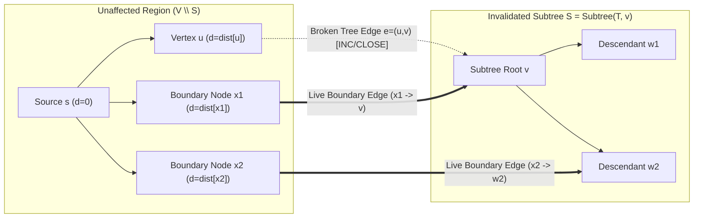

# Research Methodology & Theoretical Proof Obligations

**Project:** PathForge: A Witness-Guarded Dynamic Shortest Path Maintenance System  
**Reference Paper:** Yang P. Liu, *"Incremental Shortest Paths in Almost Linear Time via a Modified Interior Point Method"*, arXiv:2506.19207v1 (2025).

---

## 1. Background: Fixed-Source Incremental Approximate SSSP (`arXiv:2506.19207v1`)

Yang P. Liu's paper establishes a deterministic $m^{1+o(1)}$-time algorithm for maintaining $(1+\epsilon)$-approximate single-source shortest path (SSSP) distances in directed weighted graphs under **edge insertions** (`INS`). Key mechanisms in the original paper include:

1. **Modified Interior Point Method (IPM) & High-Power Barrier:** Formulates transshipment / SSSP maintenance using a specialized potential with a high-power logarithmic barrier to bound the number of Newton steps across dynamic updates.
2. **Augmented Source Edges:** Adds synthetic edges from the source $s$ to every vertex $v \in V$ whose weights track upper bounds on shortest-path distances and decrease monotonically as new edges are inserted.
3. **Distance-Drop Detection & Recursive Maintenance:** Detects vertices whose approximate distance drops by a multiplicative $(1-\epsilon')$ factor and propagates updates recursively across levels.

**Fundamental Limitation of the Original Paper:**  
The entire theoretical machinery of `arXiv:2506.19207v1` relies on **monotonicity**: edge insertions and weight decreases can only cause shortest-path distances $d(s, v)$ to **decrease or stay constant**. When an edge increases in weight (`INC`) or closes (`CLOSE`), distances can **increase**, invalidating previously certified shortest paths and violating the monotone potential decrease of the IPM solver.

---

## 2. Proposed Extension: Witness-Guarded Dynamic SSSP Maintenance

To support real-world dynamic graphs subject to all five update operations (`INS`, `DEC`, `INC`, `CLOSE`, `REOPEN`), PathForge introduces a **witness-guarded update mechanism**:

### 2.1 Shortest-Path Tree $T$ as a Collection of Witness Paths
For every reachable vertex $v \in V$, we maintain:
- Exact shortest distance `dist[v]`
- Incoming tree parent edge `parent_edge[v]` in the shortest-path tree $T$
- Euler-tour interval `[tin[v], tout[v]]` over $T$, enabling $O(1)$ subtree membership checks (`u` is in `Subtree(T, v)` iff `tin[v] <= tin[u] <= tout[v]`).

### 2.2 Monotone Reduction of `DECREASE` and `REOPEN` to `INSERT`
- **`DECREASE(e, w_new)`:** Rather than mutating $e$ in place and losing version history, we insert a parallel live edge $e_{\text{new}} = (u, v, w_{\text{new}})$ linked to `parent_edge_id = e.id`, and trigger incremental relaxation from $v$.
- **`REOPEN(e, w_reopen)`:** Reactivates connectivity across $(u, v)$ as an insertion-type relaxation event.

### 2.3 Witness-Guarded Handling of `INCREASE` and `CLOSE`
When an edge $e = (u, v)$ increases in weight or closes:
- **Case 1 ($e \notin T$ — Non-Tree Edge):**  
  Checked in $O(1)$ via `parent_edge[v] != e.id`. Because no witness path in $T$ traverses $e$, and increasing or closing $e$ cannot create a shorter path than `dist[v]`, all witness paths in $T$ remain valid and optimal. **Zero vertices are invalidated or recomputed.**
- **Case 2 ($e \in T$ — Tree Edge):**  
  Only vertices in the affected subtree $S = \text{Subtree}(T, v)$ lose their certified witness paths. All vertices $x \in V \setminus S$ retain their exact distances `dist[x]`.

---

## 3. Open Proof Obligations & Theoretical Boundaries

In accordance with the research workbook, we explicitly state what is proved for the exact prototype and what remains an open theoretical obligation for coupling with Liu's modified IPM:

### Invariants Verified in the Prototype
- **Invariant I1 (Witness Soundness):** At the end of every update, for every reachable $v \in V$, following `parent_edge` pointers from $v$ to $s$ yields a simple directed path of **live** edges whose weights sum to `dist[v]`.
- **Invariant I2 (Non-Tree Immunity):** For any `INC` or `CLOSE` on $e \notin T$, $d_{G'}(s, w) = d_G(s, w)$ for all $w \in V$.
- **Invariant I3 (Boundary Completeness for Subtree Repair):** For any `INC` or `CLOSE` on tree edge $e=(u,v) \in T$, any shortest path in $G'$ from $s$ to $y \in S = \text{Subtree}(T, v)$ consists of a prefix path entirely within $V \setminus S$ (whose length is already exactly `dist[x]`) followed by a live boundary edge $(x, y') \in E(V \setminus S, S)$ and a suffix inside $S$.

### Unproved Theoretical Obligations (Why $m^{1+o(1)}$ Is Not Claimed for Mixed Updates)
1. **Invalidation Amortization Problem:** An adversary can repeatedly close or increase edges near the root of $T$ (as tested in our `ADVERSARIAL_TREE_CLOSURE` suite), causing $|S| = \Theta(|V|)$ on consecutive updates.
2. **Potential-Cost Budget Coupling:** In `arXiv:2506.19207v1`, the barrier potential only tolerates monotone cost decreases on augmented source edges. Upward distance shifts in $S$ require paying a positive potential recharge proportional to $|S|$.
3. **IPM Solver Interface Limitation:** The dynamic linear algebraic data structures inside the modified IPM do not natively expose an $O(1)$ rollback or arbitrary positive cost shift without re-centering the interior point iterate.
